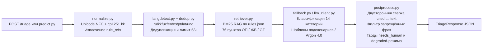

# Grand Mobile Support Copilot — Case 03 (Decentrathon 6.0)


-16a34a)


Автономный сервис триажа обращений игроков (`complaint` и `report`), поиска релевантных пунктов правил (**BM25 RAG** по `rules.json`: **76** цитируемых пунктов из разделов 30–32; глоссарий раздела 43 «RP-термины» в индекс цитат не входит) и безопасной генерации черновиков ответов для администраторов **Grand Mobile** на русском (`ru`), казахском (`kk`), узбекском (`uz`), английском (`en`), испанском (`es`) и португальском (`pt`) языках.

Внешняя LLM **не требуется**: без `LLM_API_KEY` классификация, извлечение фактов, цитаты и черновики строятся детерминированным локальным провайдером, поэтому сервис полностью воспроизводим, не ходит в сеть и не имеет стоимости на тикет.

> Полный технический отчёт с разбором метрик, проверкой цитат и бенчмарком — **[REPORT.md](./REPORT.md)**.
> Примеры запроса и ответа — **[examples/](./examples)**.

---

## 1. Ключевые показатели (проверено на `tickets_valid.jsonl`, `N = 1 000`)

| Что проверяет жюри (§9) | Как измерено | Результат | Где воспроизвести |
| :--- | :--- | :---: | :--- |
| **Классификация (25%)** | Category Accuracy по `weak`-эталону | **91.20%** (`--strip-labels`), `95.50%` (`full`), `84.80%` (`text-only`) | `make eval` |
| | Priority Macro-F1 | **93.04%** (`--strip-labels`), `94.96%` (`full`), `90.34%` (`text-only`) | `make eval` |
| **Черновики (30%)** | Уникальных черновиков на 1 000 тикетов; запрещённые обещания | **822 уникальных текста**, запрещённых фраз — **0%** | `make eval`, `make test` |
| **Без выдуманных правил (20%)** | Цитаты, проверенные по литералам `rules.json` + `taxonomy.json` | **`773 / 773`** существуют, **`0`** выдуманных правил | `make check-citations` |
| | Лишние номера правил в тексте вне `cited` | **`0`** | `make check-citations` |
| **Казахский и узбекский (15%)** | `kk` (`N = 31`): Category Accuracy / Priority Macro-F1 / язык ответа | **90.32% / 93.38% / 100%** | `make eval` |
| | `uz` (`N = 119`): Category Accuracy / Priority Macro-F1 / язык ответа | **95.80% / 97.57% / 100%** (`119/119`) | `make eval` |
| **Стоимость и латентность (10%)** | Латентность локального провайдера на 1 000 тикетов (несколько прогонов) | **p50 ≈ 0.8–0.9 мс**, **p95 ≈ 1.9–2.1 мс**, **p99 ≈ 3.8–4.3 мс** (`p95 ≪ 5 с`) | `make bench` |
| | Оценка стоимости по оценочным токенам и тарифу из `.env.example` | **≈ $0.00056 / тикет** (`≤ $0.002`), локально `$0` | `make bench` |
| **Эскалация человеку (§7.7, §10)** | `needs_human = true` / автоматически закрыто | **97.40% (`974`)** / **2.60% (`26`)** | `make predict`, `make eval` |

> **Честные оговорки по метрикам.**
> * Внешний LLM в сдаваемом режиме не подключён (`LLM_API_KEY` не требуется): сервис работает на детерминированном локальном провайдере и детализированных шаблонах категорий/подсценариев (`app/fallback.py`).
> * Метрики классификации в `make eval` рассчитаны по `weak`-эталону на валидационном наборе `tickets_valid.jsonl` (в нём поля `category` и `priority` равны `null`); на скрытых тестовых данных и при сверке с экспертной разметкой значения могут быть ниже.
> * Шаблоны на казахском (`kk`) и узбекском (`uz`) проверены автотестами на орфографию, отсутствие кириллицы в `uz` (кроме официальных префиксов `ЖБ`) и наличие казахских букв в `kk`, но не вычитывались профильными носителями языка.
> * Латентность измерена на Apple Silicon / Python 3.14; на другой машине абсолютные значения отличаются, но остаются в пределах `p95 ≪ 5 с`. Команды `docker build` / `docker run` в этой среде не запускались (нет демона Docker); сервис целиком проверен локально через `uvicorn` и `TestClient`, а `Dockerfile` собран по стандартным практикам (non-root, `HEALTHCHECK`).

---

## 2. Быстрый старт для проверяющих

### 2.0. Что нужно

* **Python 3.11+** (`python3 --version`). Опционально: `make`, Docker Desktop.
* Интернет — только на `pip install -r requirements.txt`.
* **`LLM_API_KEY` не нужен** — сервис полностью автономен.

### 2.1. Данные организаторов (обязательно для оценки, не входят в репозиторий)

По §10.2 данные handout **не входят в репозиторий, Docker-образ и сдаваемый архив**. Создайте папку и положите файлы из `grand-support-copilot-handout-2026-10-27.tgz`:

| Файл | Зачем нужен |
| :--- | :--- |
| `data/rules.json` | **обязателен** для поиска правил, цитат и `/readyz` |
| `data/taxonomy.json`, `data/tickets_valid.jsonl` | нужны для `make eval`, `make check-citations`, `make bench`, `make predict` |

```bash
mkdir -p data
```

Порядок поиска `rules.json` (`app/rules_index.py`): `RULES_PATH` → `data/rules.json` → `rules.json` → `handout/rules.json` → `../data/rules.json`.

Если `rules.json` не найден, сервис **не падает**: `GET /health` и `GET /readyz` сообщают `"status": "degraded"` (`/readyz` → HTTP 503), а все ответы `POST /triage` принудительно получают `needs_human = true` с причиной `"rules.json не загружен"`.

### 2.2. Установка и запуск

**macOS / Linux:**

```bash
python3 -m venv .venv
source .venv/bin/activate
pip install -r requirements.txt
cp .env.example .env
python -m uvicorn app.main:app --host 127.0.0.1 --port 8000
```

**Windows (PowerShell):**

```powershell
python -m venv .venv
.venv\Scripts\Activate.ps1
$env:PYTHONUTF8 = "1"
pip install -r requirements.txt
copy .env.example .env
python -m uvicorn app.main:app --host 127.0.0.1 --port 8000
```

Если PowerShell блокирует активацию: `Set-ExecutionPolicy -Scope Process Bypass`, затем повторите `.venv\Scripts\Activate.ps1`.

Признак успешного запуска: `INFO:     Uvicorn running on http://127.0.0.1:8000`.

`.env` (если создан из `.env.example`) читается автоматически при импорте пакета `app`; реальные переменные окружения имеют приоритет над файлом. Сервис работает и без `.env` — все значения по умолчанию рассчитаны на автономный режим без внешней LLM.

### 2.3. Проверка сервиса

| Проверка | Команда / адрес | Ожидаемо |
| :--- | :--- | :--- |
| Liveness | `curl http://127.0.0.1:8000/healthz` | `{"status":"ok",...}` |
| Readiness | `curl http://127.0.0.1:8000/readyz` | `{"status":"ok","rules_count":76,"sections_count":11}` |
| Health | `curl http://127.0.0.1:8000/health` | тот же статус, всегда HTTP 200 |
| Swagger UI | `http://127.0.0.1:8000/docs` | интерактивная документация |
| Админ-UI | `http://127.0.0.1:8000/admin` | очередь, черновик, кнопки «Отправить / Править / Эскалировать» |

Пример из §8.1 (жалоба на оскорбление родных в чате) — файл [`examples/triage_request.json`](./examples/triage_request.json):

```bash
curl -s -X POST http://127.0.0.1:8000/triage \
  -H "Content-Type: application/json" \
  --data @examples/triage_request.json | python3 -m json.tool
```

```powershell
Invoke-RestMethod -Method Post -Uri http://127.0.0.1:8000/triage `
  -ContentType "application/json; charset=utf-8" `
  -Body (Get-Content examples\triage_request.json -Raw) | ConvertTo-Json -Depth 8
```

Ожидаемые ключевые поля: `category = "complaint.insult"`, `priority = "p2"`, `extracted.nickname = "Arman_Petrov"`,
`extracted.has_evidence = true`, `draft_reply.cited = ["2.1"]`, `needs_human = true`, `confidence = 0.93`
(полный ответ — [`examples/triage_response.json`](./examples/triage_response.json)).

Ещё три сценария для быстрой проверки:

| Запрос | Ожидаемо |
| :--- | :--- |
| `{"kind":"report","messages":[{"role":"player","text":"Помогите, меня взломали, поменяли пароль от аккаунта и пропала машина"}]}` | `report.account`, `p0`, `needs_human = true`, `cited = ["1.4"]` |
| `{"kind":"report","messages":[{"role":"player","text":"Задонатил 1500 рублей через СБП, деньги списались с карты, а донат не пришёл"}]}` | `report.payment`, `p0`, `needs_human = true`, `cited = []` |
| `{"kind":"report","messages":[{"role":"player","text":"Помогите, застрял в текстурах под мостом!"}]}` | `report.help`, `p2`, `needs_human = false`, `cited = ["3.1"]` |

### 2.4. Пакетная обработка (`make predict`)

```bash
make predict IN=data/tickets_valid.jsonl OUT=data/pred.jsonl
```

Без `make` (Windows / macOS / Linux):

```bash
python scripts/predict.py --input data/tickets_valid.jsonl --output data/pred.jsonl --workers 8 --mode strip-labels
```

Режимы (`--mode`, он же `MODE=` для `make`):

| Режим | Что делает | Зачем |
| :--- | :--- | :--- |
| `strip-labels` (по умолчанию) | удаляет `verdict`, `violation`, `punishment`, `category`, `priority` и сообщения `role="admin"` до пайплайна | честный режим `POST /triage`, без утечки послефактум-полей |
| `full` | передаёт запись как есть | верхняя оценка при наличии `verdict` |
| `text-only` | `strip-labels` + удаление `rule_refs_raw` | только сырой текст обращения (`make eval` → `text-only`) |

Каждая строка `pred.jsonl` — `ticket_id` плюс все поля ответа `/triage` в исходном порядке файла. Ожидаемая строка вывода:

```text
[predict] Processed 1000 tickets (mode=strip-labels, needs_human=974/1000 (0.9740), auto_closed=26) -> data/pred.jsonl in ~1.0s
```

> `STRIP_LABELS=0 make predict ...` — устаревший алиас режима `full` (сохранён для обратной совместимости).

### 2.5. Тесты, оценка, цитаты, бенчмарк

```bash
make test              # pytest, если установлен, иначе unittest
make eval              # метрики на 1 000 тикетов + шаблон разметки 100 тикетов
make check-citations   # аудит всех 773 цитат и релевантности
make bench             # p50/p95/p99 и оценка стоимости (с кэшем и без)
```

Без `make`:

```bash
python -m pytest -v
python -m unittest discover -s tests -p "test_*.py" -v
python eval/run_eval.py
python eval/check_citations.py
python eval/bench.py
```

**Тесты герметичны**: `23` проверки проходят как на данных handout, так и на чистом клоне без `data/` — тогда автоматически используется синтетический набор `tests/fixtures/rules.json` с той же структурой (11 разделов, 76 цитируемых пунктов, но с авторскими формулировками, §10.2). Ожидаемый вывод: `23 passed` (pytest) или `Ran 23 tests ... OK` (unittest).

Ожидаемые значения на `data/tickets_valid.jsonl`: `category_accuracy_no_verdict_triage_mode = 0.912`, `priority_macro_f1_no_verdict_triage_mode = 0.9304`, `needs_human_count = 974`, `auto_closed_count = 26`, `total_cited_items_checked = 773`, `hallucination_rate = 0.0`, `relevance_violations_count = 2`, `p95_within_5s_sla = true`, `cost_within_0_002_sla = true`.

### 2.6. Запуск в Docker

```bash
cp .env.example .env
docker build -t grand-mobile-copilot:latest .
docker run --rm -p 8000:8000 --env-file .env -v "$PWD/data:/app/data:ro" grand-mobile-copilot:latest
```

PowerShell: `docker run --rm -p 8000:8000 --env-file .env -v "${PWD}/data:/app/data:ro" grand-mobile-copilot:latest`.

Особенности образа: `python:3.11-slim`, запуск от **non-root** пользователя, `HEALTHCHECK` на `/healthz`, `data/` монтируется read-only в `/app/data`, сами данные и модели в образ не попадают. Внутри образа можно прогнать `python -m pytest` — тесты используют fixture-набор и не требуют данных организаторов.

---

## 3. Контракт HTTP API (раздел 8.1)

| Метод | Путь | Назначение |
| :--- | :--- | :--- |
| `POST` | `/triage` | триаж одного обращения; **никогда не возвращает 5xx** (при сбое — безопасный детерминированный ответ) |
| `GET` | `/health` | диагностика: статус, версия, `rules_count`, `sections_count` (всегда 200) |
| `GET` | `/healthz` | liveness-проба (Docker/Kubernetes) |
| `GET` | `/readyz` | readiness: `200` при загруженном `rules.json`, `503` в `degraded` |
| `GET` | `/stats` | счётчики запросов, `p50`/`p95`, кэш, `dedup_groups`, размер буфера прогнозов |
| `GET` | `/predictions?limit=50` | последние ответы `/triage` для админ-очереди (сырой текст обращения не хранится) |
| `GET` | `/templates?category=&lang=` | банк безопасных шаблонов черновиков (бонус §13.2) |
| `POST` | `/clusters` | кластеризация присланных тикетов и канонический шаблон на кластер (бонус §13.2) |
| `POST` | `/admin/feedback` | сигнал администратора `send` / `edit` / `escalate` (бонус §13.3) |
| `GET` | `/feedback?limit=50` | сохранённые сигналы администраторов (новые сначала) |
| `GET` | `/admin` | HTML-интерфейс администратора (очередь, черновик, кнопки действий) |

`POST /triage` принимает `kind`, `messages` (поддержка `attachments` внутри `messages[i]`, на верхнем уровне и через `images_count`), а также `reported_nick`, `rule_refs_raw`, `server_lang`, `region`, `verdict`, `reporter_hash`, `created_at`. Ответ валидируется схемой `TriageResponse`: `lang`, `category`, `priority`, `is_spam_or_duplicate`, `extracted.{nickname, rule_refs, has_evidence, server}`, `draft_reply.{lang, text, cited}`, `needs_human`, `confidence` (0…1), `reasons` (1–3 пункта). Лишние поля входа игнорируются.

---

## 4. Архитектура и структура



```text
.
├── app/
│   ├── main.py          # FastAPI: /triage, /health(z), /readyz, /stats, /predictions, /templates, /clusters, /feedback, /admin
│   ├── schemas.py       # Pydantic 2.x модели входа/выхода (§8.1, attachments, reasons 1–3, confidence 0…1)
│   ├── pipeline.py      # Сквозной пайплайн одного тикета + метрики латентности/токенов
│   ├── normalize.py     # NFC, cp1251-искажения казахских букв, извлечение rule_refs (отсев ПГО/ГВ/СМ/ОПГ/БВ/ВЗФ/ЛД)
│   ├── langdetect.py    # Детектор языка ru/kk/uz/en/es/pt/lat/und + узбекские апострофы U+02BB/U+02BC
│   ├── rules_index.py   # Парсер разделов 30–32 rules.json (76 цитируемых пунктов), поиск путей, degraded-режим
│   ├── retriever.py     # BM25 RAG + мультиязычная база знаний, гарантирует правила категории из taxonomy.json
│   ├── llm_client.py    # Локальный детерминированный провайдер (по умолчанию) / OpenAI-совместимый Argon 4.0, SHA-256 кэш
│   ├── postprocess.py   # Кодовые гарды: cited ↔ text, kind ↔ category, needs_human, запрещённые фразы
│   ├── dedup.py         # Дедупликация reporter_hash + время + TF-IDF/MinHash + лимит 5 тикетов/час + антиспам
│   └── fallback.py      # Классификатор, confidence, шаблоны подсценариев на ru/kk/uz/en/es/pt
├── prompts/system_prompt.txt  # Промпт для внешнего провайдера ({{RULES_CONTEXT}}, {{TICKET_JSON}})
├── scripts/predict.py         # Батч JSONL: --mode full|strip-labels|text-only, порядок строк сохраняется
├── eval/
│   ├── run_eval.py            # Метрики на valid: strip-labels / full / text-only + шаблон разметки 100 тикетов
│   ├── check_citations.py     # Аудит cited по литералам rules.json/taxonomy.json, сверка с текстом, релевантность
│   └── bench.py               # Латентность p50/p95/p99 и оценка токенов/стоимости (с кэшем и без)
├── tests/
│   ├── test_copilot.py        # 23 автотеста (pytest и unittest), включая API-контракт, гарды, батч↔API и malformed body
│   └── fixtures/rules.json    # Синтетический набор правил для герметичных прогонов без данных handout
├── examples/                  # Примеры запроса/ответа /triage
├── data/                      # Вне git и вне образа: файлы handout организаторов
├── Makefile                   # predict / run / eval / check-citations / bench / test / clean-data / docker-*
├── Dockerfile                 # python:3.11-slim, non-root, HEALTHCHECK
├── pytest.ini                 # testpaths=tests, -q
├── requirements.txt           # Зависимости (верхние границы версий зафиксированы)
├── .env.example               # Шаблон конфигурации окружения
├── LICENSE                    # MIT
├── REPORT.md                  # Технический отчёт с метриками и разбором ошибок
└── README.md
```

Сервис stateless, кроме трёх вещей: кэш ответов локального провайдера (в памяти), история дедупликации (в памяти) и файл `ADMIN_FEEDBACK_PATH` (по умолчанию `data/admin_feedback.jsonl`). Достаточно одного процесса `uvicorn`; несколько воркеров не нужны, а при использовании внешней LLM только увеличат расход токенов.

---

## 5. Соответствие требованиям кейса

| Требование | Где реализовано | Как проверить |
| :--- | :--- | :--- |
| `POST /triage` по контракту §8.1 | `app/main.py`, `app/schemas.py` | `examples/`, `make test` (тесты 11, 16, 17, 19, 22, 23) |
| `make predict IN=… OUT=…` | `Makefile`, `scripts/predict.py` | `make predict …`, тест 12, 18 |
| RAG по правилам и базе знаний обязателен | `app/retriever.py`, `app/rules_index.py` | `make check-citations`, тест 2 |
| Цитаты только из `rules.json`, без выдуманных пунктов | `app/postprocess.py`, `eval/check_citations.py` | `hallucination_rate = 0.0` |
| Ответ без цитат допустим только там, где правила не нужны | `TAXONOMY_EMPTY_RULE_CATEGORIES` (`app/fallback.py`) | `empty_cited_when_required_rate = 0.0` |
| Запрет обещаний разбана/возврата/наказания | `FORBIDDEN_DRAFT_PATTERNS` (`app/postprocess.py`) | тест 9 (ru/kk/uz/en) |
| Платежи, апелляции, взлом — всегда человеку | `compute_needs_human` (+ пост-гард) | тест 15, тест 20 |
| Отчёт: метрики, примеры черновиков, доля эскалаций, стоимость, латентность | `REPORT.md` | `make eval`, `make bench`, `make check-citations` |
| Приватность: данные не в git/образе, удаление через 14 дней | `.gitignore`, `.dockerignore`, `make clean-data` | см. §6 |
| Бонус 1: дедупликация (1 игрок, 1 проблема, 5 тикетов/час) | `app/dedup.py` | тест 11 (`burst_user_01`) |
| Бонус 2: шаблоны по кластерам | `POST /clusters`, `GET /templates` | `curl`, тест 18 |
| Бонус 3: админ-UI + обучающий сигнал | `GET /admin`, `POST /admin/feedback`, `GET /feedback`, `GET /predictions` | `curl`, тесты 11, 17 |

---

## 6. Безопасность данных и приватность (раздел 10.2)

* `data/`, `user_uploaded_files/`, `*.jsonl*`, `/rules.json`, `/taxonomy.json`, `/ТРЕБОВАНИЯ.md` — в `.gitignore` и `.dockerignore`; в репозитории, образе и архиве данных нет.
* Сырой текст обращения игрока **не логируется** и **не сохраняется**: `/predictions` хранит только поля ответа `TriageResponse`, `/admin/feedback` — черновик, правку, категорию, приоритет и флаг эскалации.
* Полное удаление данных после завершения оценки:

```bash
make clean-data
# эквивалент: rm -rf data/*.jsonl data/*.jsonl.* data/rules.json data/taxonomy.json \
#             data/manual_annotation_100.jsonl data/pred*.jsonl data/*.json
```

---

## 7. Допущения и открытые вопросы (раздел 15)

1. **Формат `pred.jsonl` и очистка послефактум-полей**
   *Допущение*: строка вывода — `ticket_id` + все поля `TriageResponse` в порядке входного файла; `--mode strip-labels` (по умолчанию) удаляет `verdict`, `violation`, `punishment`, `category`, `priority` и сообщения `role="admin"` до пайплайна.
   *Если допущение неверно*: используйте `MODE=full` (или `--mode full`), чтобы подать `verdict` в пайплайн; схема ответа не меняется.

2. **Отсутствие эталонных `category`/`priority` в `tickets_valid.jsonl`**
   *Допущение*: локальные метрики считаются по детерминированному `weak`-эталону (`derive_weak_label`) из косвенных полей, плюс формируется шаблон на 100 тикетов (`data/manual_annotation_100.jsonl`) без пересечения по `reporter_hash`.
   *Если допущение неверно*: абсолютные значения `Category Accuracy` / `Priority Macro-F1` на экспертной разметке будут отличаться; сервис и генератор `pred.jsonl` от `eval/run_eval.py` не зависят.

3. **Семантика `extracted.server`**
   *Допущение*: только явно названный в тексте сервер (например, `"на 3 сервере"` → `"3"`), иначе `null`; `region`/`server_lang` не подставляются.
   *Если допущение неверно*: расходится только это вспомогательное поле.

4. **Поля `reported_nick`, `reported_hash`, `reporter_hash`**
   *Допущение*: `reported_nick` — приоритетный источник `extracted.nickname` (иначе ник извлекается регулярным выражением `Firstname_Lastname` из текста); `reported_hash` в классификаторе не используется; `reporter_hash` — только для дедупликации и лимита 5 обращений/час.
   *Если допущение неверно*: при отсутствии `reported_nick` ник всё равно извлекается из текста.

5. **Расположение `rules.json` у проверяющих**
   *Допущение*: `RULES_PATH`, затем `data/rules.json`, `rules.json`, `handout/rules.json`, `../data/rules.json`; в Docker папка `./data` монтируется в `/app/data`.
   *Если допущение неверно*: сервис работает в `degraded`-режиме (`/readyz` → 503), `cited = []`, `needs_human = true` — без падения и трейсбеков.

6. **Язык ответа для 24 тикетов с меткой `lang="kk"` и русско/украинским текстом**
   *Допущение*: черновик формируется на фактическом языке текста игрока (`ru`), а для казахских текстов — на `kk` (`app/langdetect.py`).
   *Если допущение неверно*: на этих 24 тикетах будет расхождение `draft_reply.lang = "ru"` против шумной метки `"kk"` (осознанный выбор в пользу игрока).

7. **Таблица замен cp1251 и правило автозакрытия**
   *Допущение*: таблица `ќ→қ, ґ/ѓ→ғ, ѕ→ң, є→ә, ј→ө, ў→ұ, ї→ү` применяется до `langdetect` и RAG с защитой украинских слов (`деємшиков`, `перевернітє`, `немає`). `needs_human = false` разрешён только при `confidence >= 0.8`, загруженном `rules.json`, содержательном ответе из правил/БЗ и отсутствии чувствительных слов (§7.7).
   *Если допущение неверно*: сервис будет эскалировать больше обращений (безопасная сторона) либо потребует правки таблицы замен.

---

## 8. Расхождения между описанием кейса и фактическими данными (раздел 12)

| В описании кейса | Фактически в данных (`handout`) | Как обработано в решении |
| :--- | :--- | :--- |
| Валидация названа размеченной (`category` «есть только в размеченной валидации») | В `tickets_valid.jsonl` у всех 1 000 записей `category = null` и `priority = null` (у 816 из 1 000 `violation = null`) | Оценка по `weak`-эталону в трёх режимах + шаблон разметки 100 тикетов без пересечения по `reporter_hash` |
| `lang`: `ru`, `kk`, `uz`, `en`, `und` | Встречаются также `es`, `pt`, `lat`; из 31 тикета с `lang="kk"` 24 написаны на русском/украинском (`server_lang="ru"`) | Детектор поддерживает 8 значений и отвечает на фактическом языке текста |
| README упоминает `points[].ref` как готовый идентификатор | В разделах 31–32 в `points[].ref` нет префиксов `ЖБ`/`GZ`, в тексте приклеены римские заголовки; в разделе 43 `points = []`, а 14 RP-терминов лежат в тексте раздела | `app/rules_index.py` формирует подтверждённые `taxonomy.json` ключи (76 пунктов); глоссарий RP-терминов в индекс цитат не включается |
| Таблица замен cp1251 «есть в README данных» | В выданном `README.md` таблицы замен нет | Таблица из описания кейса реализована в `app/normalize.py` |
| Черновик не должен обещать наказание | Пример ответа в §8.1 содержит «Игрок получит мут на 30 минут» и «По скриншотам видно» | `app/postprocess.py` блокирует и переписывает такие формулировки |
| `needs_human_always`: `account`, `payment`, `admin` | Ограничения также требуют эскалации апелляций и взлома | `needs_human = false` только для 26 репортов с подтверждённым ответом из правил/БЗ; остальные 974 — человеку |

---

## 9. Ограничения

* **Метрики на `valid` и `weak`-эталон**: правила классификации дорабатывались по анализу ошибок на `tickets_valid.jsonl`; на закрытом тесте значения могут быть ниже. Основная метрика жюри (слепая оценка 100 черновиков) автоматически не измеряется.
* **Без внешней LLM**: черновики строятся по шаблонам категорий и подсценариев — это гарантирует 0% выдуманных правил и `p95 ≈ 2 мс`, но не перефразирует уникальные детали нестандартных жалоб так гибко, как генеративная модель. При желании `LLM_API_KEY` включает внешний провайдер (`app/llm_client.py`), при этом все гарды остаются.
* **`kk`/`uz`** не проверялись носителями языка (только автотесты на орфографию, кириллицу и падежи).
* **`complaint.invalid`** по тексту объективно ограничен: метка в `weak`-эталоне берётся из удаляемого `verdict = "invalid_format"`, а содержимое скриншотов недоступно. Поэтому агрегированные 91.20% скрывают слабый класс (`complaint.invalid`: F1 `0.32`, recall `0.20`), а `Priority Macro-F1` опирается на `p0` с `support = 1` — подробный class-level разбор в [REPORT.md](./REPORT.md), §7.
* **2 срабатывания проверки релевантности** (`relevance_violations_count = 2`) относятся к `report.question`, где `taxonomy.json` задаёт `rules: []`, а ответ даётся по правилам `1.6` и `ЖБ 1.1.1` — это осознанное расширение, а не выдуманный пункт.
* **Docker**: `docker build` / `docker run` не выполнялись в этой среде (нет демона Docker); проверены локальный запуск, все эндпоинты и `TestClient`.

---

## 10. Если что-то не работает

| Симптом | Причина | Что делать |
| :--- | :--- | :--- |
| `python: command not found` / открывается Microsoft Store | На macOS/Linux бинарник называется `python3`; на Windows Python не в `PATH` | Используйте `python3` до активации `.venv`; на Windows переустановите Python 3.11+ с галочкой **Add python.exe to PATH** |
| `Activate.ps1 cannot be loaded because running scripts is disabled` | Политика выполнения PowerShell | `Set-ExecutionPolicy -Scope Process Bypass`, затем повторите активацию |
| `ModuleNotFoundError: No module named 'fastapi'` | Не активировано `.venv` или не выполнен `pip install -r requirements.txt` | Активируйте окружение и установите зависимости; без `pytest` тесты идут через `unittest` |
| `/readyz` возвращает `503`, `/health` — `"degraded"`, `rules_count = 0` | Нет `data/rules.json` (не смонтирован том / запуск не из корня) | Положите `data/rules.json` или задайте `RULES_PATH=/полный/путь/rules.json` |
| `pytest` не находит тесты | Запуск не из корня проекта | Запускайте из корня: `python -m pytest` (используется `pytest.ini`) |
| `Address already in use` | Порт 8000 занят | `--port 8080` (или `-p 8080:8000` в Docker) |
| `docker: command not found` / `Cannot connect to the Docker daemon` | Docker не установлен или не запущен | Запустите Docker Desktop или используйте запуск без Docker (§2.2) |
| `unrecognized arguments: —input` / `invalid reference format` | Двойной дефис заменён длинным тире при копировании | Перепечатайте `--` вручную или скопируйте команду из блока кода |
| «Кракозябры» в Windows PowerShell | Кодировка консоли не UTF-8 | `$env:PYTHONUTF8 = "1"`, `[Console]::OutputEncoding = [System.Text.Encoding]::UTF8` |
| `'make' is not recognized` на Windows | `make` не входит в стандартную поставку | Используйте прямые команды Python из §2.4–2.5 |

---

## 11. Источники и лицензии

* Данные: handout Grand Mobile × Decentrathon 6.0 — собственность организаторов, в репозитории и образе отсутствуют (§10.2).
* Код сервиса и шаблоны: собственная реализация команды, MIT (`LICENSE`).
* Внешняя LLM Argon 4.0 — опциональна, по умолчанию не используется; при включении лицензия и тариф — у провайдера.
* Python 3.11 (PSF), FastAPI (MIT), Pydantic (MIT), Uvicorn (BSD-3-Clause), pytest (MIT).
